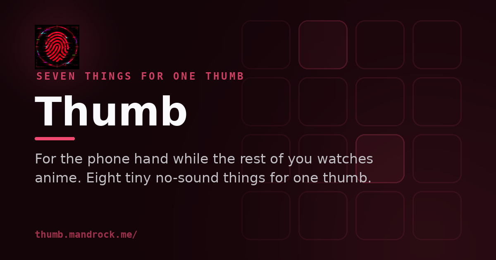

<a href="https://thumb.mandrock.me/">
  
</a>

# Thumb

Вісім тихих мініігор для однієї руки. Можна відбивати ритм, сипати пісок або ганяти кульку, поки дивишся аніме й час від часу поглядаєш на телефон.

**[Відкрити Thumb ↗](https://thumb.mandrock.me/)** · [Резервна адреса](https://mandrock.me/thumb/)

## Що є всередині

| Режим | Що робити |
| --- | --- |
| **Орбіта** | Запускай планети рогаткою навколо зірки: тягни назад і відпускай, тап дає кругову орбіту. Планети зливаються, падають у зірку або відлітають; рахуються оберти й рекорд. Система зберігається між візитами. |
| **Петля** | Свайпай за стрілкою по колу у своєму темпі. |
| **Глітч** | Торкайся для нового ефекту або веди пальцем, щоб лишити слід. Усі 200 ефектів проходять у випадковому порядку до першого повтору. |
| **Перекат** | Підхопи кульку й відпусти. Вона продовжить рух за інерцією; гіроскоп дозволяє котити її нахилом телефона. |
| **Пагін** | Тримай палець: з найближчої рослини (або з нижнього краю) росте лоза й тягнеться за ним, збоку закручуються вусики. Кожна лоза має свій колір, а на кінці розпускається бутон однієї з десяти форм (квітка, кристал, ягоди, зірка, тюльпан, спіраль, кільця, кульбаба, листя, піксельний узор). Сад зберігається між візитами. |
| **Тріщина** | Тапай по льодяній плиті: вона розколюється на уламки, дрібні вибиваються наступним ударом. Коли плита розбита, вона замерзає знову; лічильник розбитих плит зберігається. «+ Шар» затягує екран новим склом поверх (до шести шарів), «Скинути» дає чисту плиту. |
| **Кубик** | Пригадай алгоритм 3×3 і відкривай підказку по одному ходу. |
| **Пісок** | Вісім матеріалів: пісок, кислота, вода, насіння, вогонь, камінь, олія, лід. Вода вирощує рослини й гасить вогонь до пари; кислота розчиняє камінь; вогонь запалює олію і плавить лід. Ручний вибір вимикає автоколір, який можна знову увімкнути в режимі циклу або random.org. Гіроскоп керує тяжінням, композиція зберігається. |

## Локальний запуск

Потрібні Python 3 і браузер.

```sh
git clone https://github.com/0mandrock1/thumb.git
cd thumb
python3 -m http.server 8000
```

Відкрий [localhost:8000](http://localhost:8000/). Для розгортання поклади `index.html` і зображення поруч на будь-який статичний хостинг. Для власного домену онови URL у метатегах Open Graph.

## Як це влаштовано

Уся гра й код Canvas містяться в index.html, а CSS-токени, акценти й ambient завантажуються з канонічних адрес design-mandrock0. Сторінка працює без збірки, бекенда й акаунта. Автоматичний випадковий вибір кольору звертається до безключового HTTPS HTTP API random.org пакетами по 24 числа. За недоступності random.org поточний матеріал лишається, повтор через 30 секунд. Збереження піску v1 мігрує до v2 без очищення.
